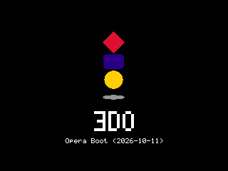

# opera-boot



opera-boot is an open-source alternative to retail 3DO boot ROMs. Its purpose
is to initialize the machine, load the operating system mastered on a 3DO CD,
and transfer control to that operating system without requiring a retail BIOS.
It does not contain Portfolio or provide an operating system of its own.

The target is a big-endian ARM60 (ARMv3) machine with MADAM, CLIO, and a
MEI-compatible CD drive, as modeled by the Opera libretro core. The ROM is a
self-contained 128 KiB image. Physical FZ-1 hardware compatibility is not
established.

There is no RSA or signature verification, downloaded boot strap, ROM driver
pack, OS-version arbitration, audio/photo-CD player, or support for non-CD
XBUS devices. The disc's OS is always selected.

<br clear="right">


## Building and using the ROM

[3DO DevKit](https://github.com/trapexit/3do-devkit), a host C compiler, and
Python 3 are required to build the `opera-boot` ROM.

```sh
source /path/to/3do-devkit/activate-env
make   # produces build/opera-boot.bin
```

The resident code, data, and private 2 KiB stack must fit below DRAM address
`0x8000`; the build checks this constraint. The ROM packer reports the image
size and hashes.

`tools/` contains only core build tools: `gen_caption.py` generates the startup
caption, `mapcheck.py` enforces the resident memory limit, and `mkrom.c` packs
the ROM. Emulator acceptance and disc-inspection utilities live in `test/`.


## Boot diagnostics

Enable Opera's `opera_kprint` option to receive boot diagnostics in its log.
Every opera-boot textual diagnostic starts with `opera-boot: `, including
boot-attempt errors and fatal traps. Continuation fields share the same prefix,
not an additional one. Emulator, disc OS, and application messages are unchanged.
After successful component loading and before kernel handoff, opera-boot reports:

- Volume identifier/commentary, unique ID, filesystem structure version/flags,
  block count/size, and physical track, label, and component-table locations.
- Selected OS, misc, splash, and permissions tags: subsystem/type,
  version/revision, flags, type-specific byte, physical sector, and byte size.
  Missing optional tags and the effective device permissions are explicit.
- Loaded component destinations and sizes, with the kernel identified.
  Legacy misc is identified as a resident replacement rather than disc code.
- Kernel AIF RO/RW/ZI sizes, its own version/revision separately from the OS
  tag version, and the selected boot-argument ABI.

The final `opera-boot: boot XXXXXXXX` line names the kernel's AIF address. This is an
OS handoff, not identification of the eventual game executable; later application
selection belongs to the OS. Filesystem structure and component versions are
not game release versions. Version/revision pairs are separate decimal bytes.

Disc text is bounded to its 32-byte field, with trailing NUL padding removed.
Embedded controls, non-ASCII bytes, quotes, and backslashes are printed as
`\xHH` escapes. Addresses, IDs, flags, and permissions are hexadecimal;
sector numbers and byte counts are decimal. Additional header metadata is
reported as unavailable if the recorded kernel payload is too short.
These diagnostics use the debug-output channel, not on-screen text.


## Documentation

* [Boot architecture](docs/BOOT_ARCHITECTURE.md): boot sequence, disc formats,
  component loading, and kernel handoff.
* [Boot reference](docs/BOOT_REFERENCE.md): hardware registers, memory layouts,
  and resident services.


## License

This project's original contributions are licensed under the
[GNU General Public License, version 2](LICENSE) (GPL-2.0-only).


## References

* https://github.com/libretro/opera-libretro
* https://www.patreon.com/trapexit/posts/announcing-3do-164834756
* https://www.twitch.tv/3dodev
* https://3dodev.com
* https://github.com/trapexit/3do-devkit


## Donations / Sponsorship

If you find the work I'm doing valuable please consider supporting its
ongoing development.

https://github.com/trapexit/support
